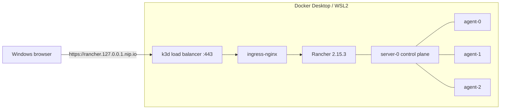

I wanted a Kubernetes cluster that behaves like the real thing but lives on one Windows PC: one control plane, three schedulable workers, an ingress controller, and a proper management UI. Not a toy single-node setup — a cluster where I can demonstrate node scheduling, pod anti-affinity, and self-service deployments.

The trick is **k3d**. It runs k3s inside Docker containers, so every "node" is a real k3s node with its own kubelet and containerd, all sharing one Windows machine. Four nodes take about two minutes to create.

Here is the exact setup I built, including the problems I hit and how I fixed them.

## Why k3d instead of k3s directly in WSL?

Installing k3s inside WSL2 gives you one node. To get three workers you would need three more Linux environments, plus a lot of networking glue. k3d gives you the same multi-node topology with one command, and `k3d cluster delete` removes everything cleanly.

What you get:

- 1 × control plane (`server-0`)
- 3 × workers (`agent-0`, `agent-1`, `agent-2`)
- A Docker-based load balancer in front of the cluster for ports 80 and 443
- Normal `kubectl` access from Windows

## What you need

- Windows 10 or 11 with **WSL2** enabled
- **Docker Desktop** with the WSL2 backend
- At least 8 GB of free RAM (the lab used roughly 3–4 GB)
- Ports **80**, **443**, and **6443** free on the host
- `kubectl`, `helm`, and `k3d`

I pinned **k3s v1.36.5**, because Rancher 2.15 supports Kubernetes 1.34–1.36. The newest k3s at the time (v1.37) was not yet supported by Rancher, and this mismatch is the kind of thing that causes confusing failures later.

## Architecture



## Step 1 — Install the tooling

```powershell
winget install -e --id Docker.DockerDesktop
winget install -e --id k3d.k3d
winget install -e --id Helm.Helm
winget install -e --id Kubernetes.kubectl
```

Start Docker Desktop and confirm the engine is up:

```powershell
docker info --format '{{.ServerVersion}}'
# 29.8.2
```

Check k3d:

```powershell
k3d version
# k3d version v5.9.0
```

## Step 2 — Create the cluster

This is the whole cluster definition:

```powershell
k3d cluster create rancher-lab `
  --servers 1 --agents 3 `
  --image rancher/k3s:v1.36.5-k3s1 `
  --api-port 127.0.0.1:6443 `
  --port 80:80@loadbalancer --port 443:443@loadbalancer `
  --k3s-arg "--disable=traefik@server:0" `
  --k3s-arg "--tls-san=rancher.127.0.0.1.nip.io@server:0" `
  --wait
```

What each flag does:

| Flag | Why |
|---|---|
| `--servers 1 --agents 3` | One control plane, three workers |
| `--image rancher/k3s:v1.36.5-k3s1` | Pin a k3s version supported by Rancher |
| `--api-port 127.0.0.1:6443` | Stable Kubernetes API endpoint on the host |
| `--port 80:80@loadbalancer` | Publish HTTP through the k3d load balancer |
| `--k3s-arg "--disable=traefik@server:0"` | Disable the bundled Traefik; we install ingress-nginx instead |
| `--tls-san=rancher.127.0.0.1.nip.io` | Add the Rancher hostname to the API server certificate |

k3d writes a `k3d-rancher-lab` context into your kubeconfig and switches to it automatically.

## Step 3 — Verify the nodes

```bash
kubectl get nodes -o wide
```

```text
NAME                       STATUS   ROLES           VERSION
k3d-rancher-lab-agent-0    Ready    <none>          v1.36.5+k3s1
k3d-rancher-lab-agent-1    Ready    <none>          v1.36.5+k3s1
k3d-rancher-lab-agent-2    Ready    <none>          v1.36.5+k3s1
k3d-rancher-lab-server-0   Ready    control-plane   v1.36.5+k3s1
```

Four `Ready` nodes. The control plane does not run your application pods by default.

## Step 4 — Ingress and certificates

Rancher needs an ingress controller. k3d's load balancer forwards traffic to the node's port 80/443, so the controller must listen on **every** node. That means a DaemonSet with `hostPort` enabled:

```bash
helm repo add ingress-nginx https://kubernetes.github.io/ingress-nginx
helm repo update

helm install ingress-nginx ingress-nginx/ingress-nginx \
  -n ingress-nginx --create-namespace \
  --set controller.kind=DaemonSet \
  --set controller.hostPort.enabled=true \
  --set controller.service.type=ClusterIP \
  --set controller.ingressClassResource.default=true \
  --wait
```

Then cert-manager, which Rancher uses to issue its self-signed certificate:

```bash
helm repo add jetstack https://charts.jetstack.io
helm repo update

helm install cert-manager jetstack/cert-manager \
  -n cert-manager --create-namespace \
  --set crds.enabled=true \
  --wait
```

## Step 5 — Install Rancher

```bash
helm repo add rancher-stable https://releases.rancher.com/server-charts/stable
helm repo update

helm install rancher rancher-stable/rancher \
  -n cattle-system --create-namespace \
  --set hostname=rancher.127.0.0.1.nip.io \
  --set bootstrapPassword='RancherLab2026!' \
  --set replicas=1 \
  --set ingress.tls.source=rancher \
  --set ingress.ingressClassName=nginx \
  --wait --timeout 12m
```

Rancher pulls a large image, so this step is the slowest. If it times out, the pods may still be pulling; check `kubectl -n cattle-system get pods` before reinstalling.

Open **https://rancher.127.0.0.1.nip.io**. The self-signed certificate means the browser will warn you once.

## Step 6 — First login


*The bootstrap login. Rancher tells you exactly where the password lives.*

You already know the bootstrap password because you passed it to Helm. If you did not, retrieve it:

```bash
kubectl get secret --namespace cattle-system bootstrap-secret \
  -o go-template='{{.data.bootstrapPassword|base64decode}}{{"\n"}}'
```

After logging in, Rancher asks for the server URL and acceptance of the terms:


*First-run setup: confirm the server URL and accept the EULA.*

Rancher 2.15 drops you straight onto the dashboard. Change the bootstrap password afterwards from the user menu → **Account and API Keys**.


*The cluster list. One cluster — `local` — running k3s v1.36.5.*

## Step 7 — Meet the cluster

Open the `local` cluster to get the cluster dashboard:


*Cluster dashboard: provider, Kubernetes version, capacity, and events.*

Then look at **Cluster → Nodes**:


This is the screenshot that makes the lab worth it: one **Control Plane** and three **Worker** nodes, all `Active`, all on the same k3s version.

## Step 8 — Deploy a 3-replica application

To prove the topology is real, deploy nginx with three replicas, one per worker. Pod anti-affinity prevents two replicas from landing on the same node, and node affinity keeps the control plane free for cluster components.

```yaml
apiVersion: apps/v1
kind: Deployment
metadata:
  name: nginx
  namespace: default
spec:
  replicas: 3
  selector:
    matchLabels:
      app: nginx
  template:
    metadata:
      labels:
        app: nginx
    spec:
      affinity:
        nodeAffinity:
          requiredDuringSchedulingIgnoredDuringExecution:
            nodeSelectorTerms:
              - matchExpressions:
                  - key: node-role.kubernetes.io/control-plane
                    operator: DoesNotExist
        podAntiAffinity:
          requiredDuringSchedulingIgnoredDuringExecution:
            - labelSelector:
                matchLabels:
                  app: nginx
              topologyKey: kubernetes.io/hostname
      containers:
        - name: nginx
          image: nginx:alpine
          ports:
            - containerPort: 80
          resources:
            requests: { cpu: 50m, memory: 64Mi }
            limits: { cpu: 200m, memory: 128Mi }
---
apiVersion: v1
kind: Service
metadata:
  name: nginx
  namespace: default
spec:
  selector:
    app: nginx
  ports:
    - port: 80
      targetPort: 80
---
apiVersion: networking.k8s.io/v1
kind: Ingress
metadata:
  name: nginx
  namespace: default
spec:
  ingressClassName: nginx
  rules:
    - host: nginx.127.0.0.1.nip.io
      http:
        paths:
          - path: /
            pathType: Prefix
            backend:
              service:
                name: nginx
                port:
                  number: 80
```

```bash
kubectl apply -f demo-app.yaml
kubectl -n default rollout status deploy/nginx
```

In Rancher, **Workloads → Deployments** shows the deployment healthy at 3/3:


**Workloads → Pods** shows the scheduling result:


Three pods, three different worker nodes. That is the whole point of a multi-node lab.

The ingress answers on `nginx.127.0.0.1.nip.io`:


## Problems I hit (and fixes)

### ImagePullBackOff with `no such host`

The first Rancher pod would not start: `failed to resolve reference "docker.io/rancher/rancher:v2.15.3"` and `lookup registry-1.docker.io: no such host`.

DNS inside the Docker VM was flaky. The fix was to give Docker Engine explicit upstream DNS servers in `%USERPROFILE%\.docker\daemon.json`, then restart Docker Desktop:

```json
{
  "builder": { "gc": { "defaultKeepStorage": "20GB", "enabled": true } },
  "experimental": false,
  "dns": ["1.1.1.1", "8.8.8.8"]
}
```

I used my ISP's resolvers plus a public fallback. After the restart, the pull completed on the next attempt.

### Rancher stuck in `ContainerCreating`

That was the same DNS problem. Watch the events instead of guessing:

```bash
kubectl -n cattle-system get events --sort-by=.lastTimestamp
```

### Port 80 or 443 already in use

k3d fails fast if the host ports are taken. Either stop the other service (IIS, another container) or map different host ports:

```bash
--port 8080:80@loadbalancer --port 8443:443@loadbalancer
```

Then use `http://rancher.127.0.0.1.nip.io:8080`.

### Browser refuses plain HTTP to a private address

Some Chromium-based browsers block `http://` to `127.0.0.1` hosts. Use HTTPS, or a locally trusted certificate, when demoing ingress endpoints.

### Rancher routes changed in 2.15

Deep links like `/explorer/workloads` now return **"Resource type workloads not found"**. The current paths are `/explorer/apps.deployment` and `/explorer/pod`. When in doubt, navigate through the sidebar instead of bookmarking old URLs.

## Tear down

```powershell
k3d cluster delete rancher-lab
```

That removes the four nodes, the load balancer, and the Docker network. Your kubeconfig context goes with it. If you added the explicit DNS entries only for this lab, remove them from `daemon.json` and restart Docker Desktop.

## Final thoughts

For a lab, k3d is the sweet spot: a real multi-node k3s cluster, a real ingress path, and a real Rancher install — with none of the VM overhead. Total disk cost is a few gigabytes of images, and the whole cluster can be recreated from one command.

The next things I want to add are persistent storage through the local-path provisioner, a GitOps demo with Fleet (already bundled with Rancher), and a second cluster registered as a downstream cluster to show Rancher's multi-cluster view.
