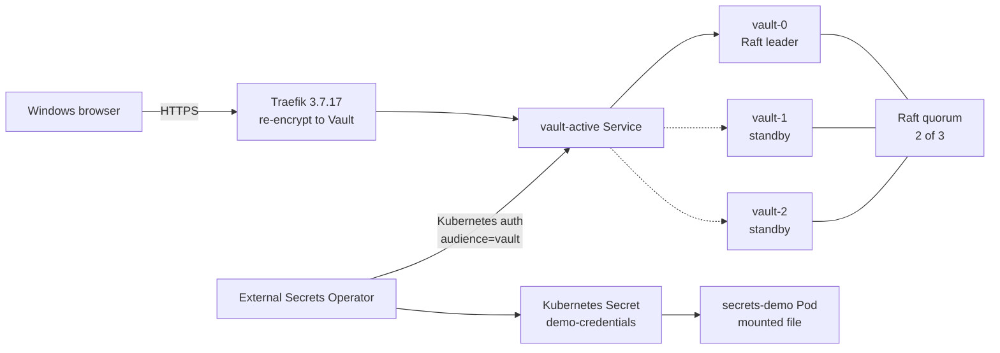

A Kubernetes `Secret` is convenient, but it is not a secret manager. It is base64-encoded data in etcd, readable by anyone with the right RBAC, and usually duplicated across namespaces and clusters.

HashiCorp Vault gives you a central system of record with policies, audit logging, leases, rotation, and a real security boundary. The External Secrets Operator (ESO) closes the last mile: it authenticates to Vault, reads only the paths a workload is allowed to read, and materializes the result as a native Kubernetes `Secret`.

This is the setup I actually deployed on my Windows k3d lab: **one control plane, three workers, three Vault nodes, TLS end to end, Raft HA, audit logging, least-privilege Kubernetes auth, and a live rotation test**. It is not a copy-paste “Vault dev server” tutorial.


## What we are building

- A 4-node k3d cluster: 1 server and 3 agents, running k3s `v1.36.5+k3s1`
- Rancher `2.15.3` and Traefik `3.7.17` already managing the lab
- cert-manager `1.21.3` issuing an internal CA and a Vault server certificate
- Vault chart `0.34.1`, running Vault `2.0.4`
- Three Vault pods, each with its own Raft data volume and audit volume
- Vault Kubernetes auth scoped to the ESO service account, namespace, and audience
- External Secrets Operator `2.14.0`
- A demo workload that receives the secret as a mounted file and sees a rotation without restarting

## Architecture



The important part is not the diagram. It is the trust chain:

1. ESO asks Kubernetes for a short-lived service account token with audience `vault`.
2. Vault verifies that token with the Kubernetes TokenReview API.
3. Vault checks the service account name, namespace, and audience against the `eso` role.
4. Vault issues an ESO token with only the `eso-read` policy.
5. ESO reads `secret/data/demo` and writes a native Kubernetes `Secret`.
6. The workload consumes the mounted file, not a hard-coded value.

## Prerequisites

This article assumes the lab from my previous post:

- Windows 10/11 with WSL2 and Docker Desktop
- k3d cluster named `rancher-lab`
- `kubectl` pointed at the `k3d-rancher-lab` context
- Helm, cert-manager, Rancher, and Traefik already installed
- `vault` CLI available in WSL for the API operations

Confirm the cluster before adding security infrastructure:

```bash
kubectl config current-context
kubectl get nodes -o wide
```

```text
NAME                       STATUS   ROLES           AGE   VERSION
k3d-rancher-lab-agent-0    Ready    <none>          21h   v1.36.5+k3s1
k3d-rancher-lab-agent-1    Ready    <none>          21h   v1.36.5+k3s1
k3d-rancher-lab-agent-2    Ready    <none>          21h   v1.36.5+k3s1
k3d-rancher-lab-server-0   Ready    control-plane  21h   v1.36.5+k3s1
```


## Step 1 — Create a private CA and a Vault certificate

Do not run Vault over plain HTTP just because the cluster is local. TLS is part of the security model, and the Raft peer traffic should be authenticated too.

I used cert-manager with a lab root CA. This is an internal CA, so it is appropriate for a homelab. In a real environment, use your organization’s PKI or a publicly trusted issuer.

```yaml
# pki-issuer.yaml
apiVersion: cert-manager.io/v1
kind: ClusterIssuer
metadata:
  name: lab-selfsigned
spec:
  selfSigned: {}
---
apiVersion: cert-manager.io/v1
kind: Certificate
metadata:
  name: lab-root-ca
  namespace: cert-manager
spec:
  isCA: true
  commonName: lab-root-ca
  secretName: lab-root-ca
  duration: 87600h
  privateKey:
    algorithm: ECDSA
    size: 256
  issuerRef:
    name: lab-selfsigned
    kind: ClusterIssuer
---
apiVersion: cert-manager.io/v1
kind: ClusterIssuer
metadata:
  name: lab-ca
spec:
  ca:
    secretName: lab-root-ca
```

Apply the issuer, then create the Vault namespace and certificate:

```bash
kubectl apply -f pki-issuer.yaml
kubectl create namespace vault

kubectl -n cert-manager wait --for=condition=Ready certificate/lab-root-ca --timeout=120s
```

```yaml
# pki-vault-cert.yaml
apiVersion: cert-manager.io/v1
kind: Certificate
metadata:
  name: vault-server-tls
  namespace: vault
spec:
  secretName: vault-server-tls
  duration: 8760h
  renewBefore: 720h
  commonName: vault.vault.svc
  privateKey:
    algorithm: RSA
    size: 2048
  issuerRef:
    name: lab-ca
    kind: ClusterIssuer
  ipAddresses:
    - 127.0.0.1
  dnsNames:
    - vault
    - vault.vault
    - vault.vault.svc
    - vault.vault.svc.cluster.local
    - vault-active.vault.svc
    - vault-active.vault.svc.cluster.local
    - vault-standby.vault.svc
    - vault-standby.vault.svc.cluster.local
    - vault.127.0.0.1.nip.io
    - vault-0.vault-internal
    - vault-1.vault-internal
    - vault-2.vault-internal
```

```bash
kubectl apply -f pki-vault-cert.yaml
kubectl -n vault wait --for=condition=Ready certificate/vault-server-tls --timeout=120s
```

Every name used by the API, the active/standby services, the ingress, and the Raft peers must be in the SAN list. A certificate that only contains `vault.vault.svc` will break the moment Traefik connects through `vault-active` or a peer connects through `vault-1.vault-internal`.

## Step 2 — Create a Traefik transport for re-encryption

Traefik terminates the browser’s TLS connection. Vault is also serving TLS on port 8200. That means Traefik must open a second TLS connection to Vault and verify the Vault certificate.

Create this `ServersTransport` before installing Vault:

```yaml
# servers-transport.yaml
apiVersion: traefik.io/v1alpha1
kind: ServersTransport
metadata:
  name: vault-transport
  namespace: vault
spec:
  rootCAs:
    - secret: vault-server-tls
  serverName: vault.vault.svc
```

```bash
kubectl apply -f servers-transport.yaml
```

`serverName` is what makes verification work when Traefik connects to a pod IP. The certificate says `vault.vault.svc`; without SNI and this override, Traefik tries to verify the pod IP and fails.

There is one non-obvious detail here: the Traefik annotations go on the **backend Service**, not on the Ingress. I will show the exact annotation and the error it fixes later, because this was the most time-consuming problem in the entire build.

## Step 3 — Install Vault with Raft HA and TLS

Add the HashiCorp repository:

```bash
helm repo add hashicorp https://helm.releases.hashicorp.com
helm repo update
```

Here is the values file that was actually deployed. It uses three Raft voters, TLS on both the API and cluster listener, persistent data and audit volumes, anti-affinity across workers, and a Traefik ingress.

```yaml
# values.yaml
global:
  enabled: true
  tlsDisable: false

injector:
  enabled: false

csi:
  enabled: false

ui:
  enabled: true

server:
  ha:
    enabled: true
    replicas: 3
    apiAddr: "https://vault.vault.svc:8200"
    raft:
      enabled: true
      setNodeId: true
      config: |
        ui = true
        disable_mlock = true

        listener "tcp" {
          address = "[::]:8200"
          cluster_address = "[::]:8201"
          tls_cert_file = "/vault/userconfig/vault-server-tls/tls.crt"
          tls_key_file  = "/vault/userconfig/vault-server-tls/tls.key"
          tls_client_ca_file = "/vault/userconfig/vault-server-tls/ca.crt"
          tls_min_version = "tls12"
        }

        storage "raft" {
          path = "/vault/data"
          retry_join {
            leader_api_addr = "https://vault-0.vault-internal:8200"
            leader_ca_cert_file = "/vault/userconfig/vault-server-tls/ca.crt"
            leader_client_cert_file = "/vault/userconfig/vault-server-tls/tls.crt"
            leader_client_key_file = "/vault/userconfig/vault-server-tls/tls.key"
          }
          retry_join {
            leader_api_addr = "https://vault-1.vault-internal:8200"
            leader_ca_cert_file = "/vault/userconfig/vault-server-tls/ca.crt"
            leader_client_cert_file = "/vault/userconfig/vault-server-tls/tls.crt"
            leader_client_key_file = "/vault/userconfig/vault-server-tls/tls.key"
          }
          retry_join {
            leader_api_addr = "https://vault-2.vault-internal:8200"
            leader_ca_cert_file = "/vault/userconfig/vault-server-tls/ca.crt"
            leader_client_cert_file = "/vault/userconfig/vault-server-tls/tls.crt"
            leader_client_key_file = "/vault/userconfig/vault-server-tls/tls.key"
          }
        }

        service_registration "kubernetes" {}

  dataStorage:
    enabled: true
    size: 1Gi
    storageClass: local-path

  auditStorage:
    enabled: true
    size: 1Gi
    storageClass: local-path

  extraVolumes:
    - type: secret
      name: vault-server-tls

  extraEnvironmentVars:
    VAULT_CACERT: /vault/userconfig/vault-server-tls/ca.crt

  resources:
    requests:
      cpu: 250m
      memory: 256Mi
    limits:
      cpu: "1"
      memory: 1Gi

  affinity: |
    nodeAffinity:
      requiredDuringSchedulingIgnoredDuringExecution:
        nodeSelectorTerms:
          - matchExpressions:
              - key: node-role.kubernetes.io/control-plane
                operator: DoesNotExist
    podAntiAffinity:
      requiredDuringSchedulingIgnoredDuringExecution:
        - labelSelector:
            matchLabels:
              app.kubernetes.io/name: vault
              component: server
          topologyKey: kubernetes.io/hostname

  service:
    active:
      annotations:
        traefik.ingress.kubernetes.io/service.serversscheme: https
        traefik.ingress.kubernetes.io/service.serverstransport: vault-vault-transport@kubernetescrd

  ingress:
    enabled: true
    ingressClassName: traefik
    hosts:
      - host: vault.127.0.0.1.nip.io
        paths:
          - /
    tls:
      - secretName: vault-server-tls
        hosts:
          - vault.127.0.0.1.nip.io
```

Install it:

```bash
helm upgrade --install vault hashicorp/vault `\
  --namespace vault `\
  --create-namespace `\
  -f values.yaml
```

Do **not** add `--wait` here. The Vault pods are deliberately sealed after startup, so their readiness probes fail until you initialize and unseal them. Helm would sit there until it times out.

Watch the pods:

```bash
kubectl -n vault get pods -w
```

```text
vault-0   0/1   Running   0   45s
vault-1   0/1   Running   0   45s
vault-2   0/1   Running   0   45s
```

`0/1` is expected. It means “running, but sealed”, not “broken”.

## Step 4 — Initialize and unseal the cluster

The first node bootstraps the Raft cluster. The other two join through `retry_join` and then need the same unseal shares.

Start by saving the CA so the local `vault` CLI can verify the ingress certificate:

```bash
kubectl -n vault get secret vault-server-tls `\
  -o jsonpath='{.data.ca\.crt}' | base64 -d > ca.crt

export VAULT_ADDR="https://vault.127.0.0.1.nip.io"
export VAULT_CACERT="$PWD/ca.crt"
```

Initialize Vault with three shares and a threshold of two:

```bash
vault operator init `\
  -key-shares=3 `\
  -key-threshold=2 `\
  -format=json > init.json
```

`init.json` contains the unseal keys and the initial root token. Treat it like a private key: move it offline, encrypt it, and never commit it. The root token is for bootstrap only. Do not build applications around it.

Unseal `vault-0` first:

```bash
vault operator unseal
# paste unseal key 1
vault operator unseal
# paste unseal key 2
```

Then confirm the followers have joined:

```bash
kubectl -n vault exec vault-1 -- vault status
kubectl -n vault exec vault-2 -- vault status
```

When they show `Initialized true` and `Sealed true`, unseal each one with the same two keys:

```bash
kubectl -n vault exec -it vault-1 -- vault operator unseal
kubectl -n vault exec -it vault-1 -- vault operator unseal

kubectl -n vault exec -it vault-2 -- vault operator unseal
kubectl -n vault exec -it vault-2 -- vault operator unseal
```

The important sequence is: unseal the leader first, let the followers join Raft, then unseal the followers. If you try to unseal a follower before it has joined, it has nothing to unseal into.

Verify the quorum:

```bash
export VAULT_TOKEN="$(jq -r .root_token init.json)"
vault operator raft list-peers
```

```text
Node       Address                        State       Voter
----       -------                        -----       -----
vault-0    vault-0.vault-internal:8201    leader      true
vault-1    vault-1.vault-internal:8201    follower    true
vault-2    vault-2.vault-internal:8201    follower    true
```


At this point the Vault UI is reachable at `https://vault.127.0.0.1.nip.io` and the cluster is ready for policy work.

## Step 5 — Turn on audit logging, KV v2, and least-privilege auth

### Audit logging

The chart mounts the audit PVC at `/vault/audit`. Confirm it, then enable a file audit device:

```bash
kubectl -n vault exec vault-0 -- ls -la /vault/audit
vault audit enable -path=file file file_path=/vault/audit/vault-audit.log log_raw=false
```

```bash
kubectl -n vault exec vault-0 -- tail -n 1 /vault/audit/vault-audit.log
```

The audit log records requests and responses with sensitive values HMAC’d. In production, ship this log to append-only storage and alert on tampering. A local file on the same PVC as Vault is not an audit strategy by itself.

### KV v2

The Helm chart does not create a KV mount. Create one:

```bash
vault secrets enable -path=secret kv-v2
```

Write the demo secret:

```bash
vault kv put secret/demo `\
  username=app-user `\
  password='demo-S3cure-2026!'
```

The UI now shows `secret/` and the `demo` secret at version 1.


### The read-only policy

ESO should not be able to read every secret. Give it exactly one path:

```hcl
# eso-read.hcl
path "secret/data/demo" {
  capabilities = ["read"]
}
```

```bash
vault policy write eso-read - < eso-read.hcl
```


### Kubernetes auth

Vault needs permission to create TokenReviews. Bind the built-in `system:auth-delegator` role to the Vault service account:

```yaml
# vault-auth-rbac.yaml
apiVersion: rbac.authorization.k8s.io/v1
kind: ClusterRoleBinding
metadata:
  name: vault-auth-delegator
roleRef:
  apiGroup: rbac.authorization.k8s.io
  kind: ClusterRole
  name: system:auth-delegator
subjects:
  - kind: ServiceAccount
    name: vault
    namespace: vault
```

```bash
kubectl apply -f vault-auth-rbac.yaml
```

Enable the auth method and point it at the in-cluster API:

```bash
vault auth enable kubernetes

vault write auth/kubernetes/config `\
  kubernetes_host="https://kubernetes.default.svc:443" `\
  kubernetes_ca_cert=@/var/run/secrets/kubernetes.io/serviceaccount/ca.crt `\
  issuer="https://kubernetes.default.svc.cluster.local" `\
  disable_iss_validation=false
```

The `issuer` value must match what k3s puts in service account tokens. You can confirm it with:

```bash
kubectl get --raw /.well-known/openid-configuration
```

```json
{"issuer":"https://kubernetes.default.svc.cluster.local","jwks_uri":"https://172.21.0.4:6443/openid/v1/jwks"}
```

Create a role that is bound to the ESO service account and requires the `vault` audience:

```bash
vault write auth/kubernetes/role/eso `\
  bound_service_account_names=external-secrets `\
  bound_service_account_namespaces=external-secrets `\
  audience=vault `\
  policies=eso-read `\
  token_ttl=1h `\
  token_max_ttl=24h
```

There is a version trap here. Vault 2.0.4’s Kubernetes auth role schema uses the singular field **`audience`**. Passing `audiences` or `bound_audiences` is silently ignored by the endpoint and you get a warning that the role has no audience. Check the actual schema if you are on a different Vault version:

```bash
vault path-help auth/kubernetes/role/eso | grep -i -A2 audience
```


## Step 6 — Install External Secrets Operator

Vault now has the secret, the policy, and a Kubernetes auth role. The missing piece is a controller that can authenticate as the ESO service account, read the allowed path, and reconcile a native Kubernetes `Secret`.

Install ESO with its CRDs:

~~~bash
helm repo add external-secrets https://charts.external-secrets.io
helm repo update

helm upgrade --install external-secrets external-secrets/external-secrets \
  --namespace external-secrets \
  --create-namespace \
  --version 2.14.0 \
  --set installCRDs=true
~~~

The release should produce three workloads:

~~~bash
kubectl -n external-secrets get deploy,pod
~~~

~~~text
deployment.apps/external-secrets                 1/1
deployment.apps/external-secrets-cert-controller 1/1
deployment.apps/external-secrets-webhook         1/1

pod/external-secrets-86d6ff5b8c-xnslr                   1/1   Running
pod/external-secrets-cert-controller-56c6d7984f-7nt9x   1/1   Running
pod/external-secrets-webhook-85b48984b9-fh4hl           1/1   Running
~~~

The exact image in this lab was:

~~~text
ghcr.io/external-secrets/external-secrets:v2.14.0
~~~

The service account referenced by Vault is created by the chart:

~~~bash
kubectl -n external-secrets get serviceaccount external-secrets
~~~

### Create the Vault-backed ClusterSecretStore

The store is the connection between ESO and Vault. It contains the Vault address, the CA, the auth mount, the role, and the audience.

~~~yaml
# cluster-secret-store.yaml
apiVersion: external-secrets.io/v1
kind: ClusterSecretStore
metadata:
  name: vault-backend
spec:
  provider:
    vault:
      server: https://vault.vault.svc:8200
      path: secret
      version: v2
      caProvider:
        type: Secret
        name: vault-server-tls
        key: ca.crt
        namespace: vault
      auth:
        kubernetes:
          mountPath: kubernetes
          role: eso
          serviceAccountRef:
            name: external-secrets
            namespace: external-secrets
            audiences:
              - vault
~~~

~~~bash
kubectl apply -f cluster-secret-store.yaml
~~~

There are four details worth slowing down for:

- **`server` uses the in-cluster DNS name.** ESO talks to `vault.vault.svc:8200`, not through the browser ingress. Traefik is for humans and external clients; the controller should stay inside the cluster network.
- **`caProvider` points to the CA in the Vault namespace.** `ClusterSecretStore` is cluster-scoped, but the referenced `Secret` is namespaced. The explicit `namespace: vault` is required.
- **`serviceAccountRef.namespace` is required for a `ClusterSecretStore`.** Without it, ESO cannot reliably resolve the service account that Vault is supposed to trust.
- **`audiences: [vault]` must match the Vault role.** This is not decorative. Vault 1.21 and later require the audience to be present when the role is used.

The Vault provider documentation also calls out both namespace requirements and the audience change. I verified the current ESO provider docs against the live resources rather than relying on an older example.

Check the store:

~~~bash
kubectl get clustersecretstore vault-backend
~~~

~~~text
NAME            AGE   STATUS   CAPABILITIES   READY
vault-backend   23m   Valid    ReadWrite      True
~~~

If `READY` is `False`, inspect the condition message before changing anything:

~~~bash
kubectl get clustersecretstore vault-backend \
  -o jsonpath='{range .status.conditions[*]}{.type}={.status} {.reason}: {.message}{"\n"}{end}'
~~~

A valid store means ESO could reach Vault, trust its certificate, and authenticate with the Kubernetes role. It does **not** mean ESO can read every secret. The `eso-read` policy still limits it to `secret/data/demo`.

## Step 7 — Sync the Vault secret into Kubernetes

Now create the `ExternalSecret` and a small workload that consumes the result as a mounted file.

~~~yaml
# eso-demo.yaml
apiVersion: external-secrets.io/v1
kind: ExternalSecret
metadata:
  name: demo-credentials
  namespace: default
spec:
  refreshInterval: 30s
  secretStoreRef:
    name: vault-backend
    kind: ClusterSecretStore
  target:
    name: demo-credentials
    creationPolicy: Owner
  data:
    - secretKey: username
      remoteRef:
        key: demo
        property: username
    - secretKey: password
      remoteRef:
        key: demo
        property: password
---
apiVersion: apps/v1
kind: Deployment
metadata:
  name: secrets-demo
  namespace: default
spec:
  replicas: 1
  selector:
    matchLabels:
      app: secrets-demo
  template:
    metadata:
      labels:
        app: secrets-demo
    spec:
      containers:
        - name: app
          image: busybox:1.36
          command: ["sh", "-c", "while true; do sleep 3600; done"]
          volumeMounts:
            - name: credentials
              mountPath: /etc/demo-secret
              readOnly: true
      volumes:
        - name: credentials
          secret:
            secretName: demo-credentials
~~~

~~~bash
kubectl apply -f eso-demo.yaml
kubectl -n default wait \
  --for=condition=Ready externalsecret/demo-credentials \
  --timeout=120s
~~~

The remote reference uses `key: demo`, not `key: secret/data/demo`. The store already sets `path: secret` and `version: v2`; ESO resolves the KV v2 data path for you. The `property` field selects one key from the Vault payload.

Verify the synchronization:

~~~bash
kubectl -n default get externalsecret demo-credentials
~~~

~~~text
NAME              STORETYPE            STORE           REFRESH INTERVAL   STATUS         READY   LAST SYNC
demo-credentials  ClusterSecretStore   vault-backend   30s                SecretSynced   True    30s
~~~

The resulting object is a normal Kubernetes `Secret`:

~~~bash
kubectl -n default get secret demo-credentials
kubectl -n default get secret demo-credentials \
  -o jsonpath='{.data.username}' | base64 -d
echo
~~~

~~~text
app-user
~~~


Confirm the workload sees the value through the mounted file:

~~~bash
kubectl -n default exec deploy/secrets-demo -- \
  cat /etc/demo-secret/password
~~~

~~~text
rotated-S3cure-2026!
~~~

This is the point where the architecture becomes useful in practice. The application does not call Vault, does not know a Vault address, and does not need a Vault token. Its deployment asks Kubernetes for a volume. ESO keeps that volume's backing Secret synchronized with Vault.

### Important security boundary

ESO is a synchronization system, not a runtime secret broker. The value is still materialized into a Kubernetes `Secret`, which means:

- It is stored in etcd. Enable Kubernetes encryption at rest and protect the encryption key.
- It is readable by anyone with permission to read Secrets in that namespace.
- It can be copied by a cluster administrator.
- It remains in the pod's volume and in the kubelet's secret cache.

That is acceptable for many workloads, but do not describe it as “the secret never exists in Kubernetes.” If the requirement is to avoid native Secret objects entirely, look at the Vault Secrets Store CSI driver or another runtime-injection design. Those have their own operational trade-offs, including node plugins and CSI lifecycle management.

The ESO pattern is still a major improvement over copying long-lived credentials into Git or manually creating Secrets. The credential source of truth is Vault, access is auditable, and rotation can be automated.

## Step 8 — Prove rotation without restarting the pod

A synchronization claim is only useful if the value changes. Rotate the password in Vault and watch the Kubernetes Secret update.

First record the pod UID:

~~~bash
kubectl -n default get pod \
  -l app=secrets-demo \
  -o jsonpath='{.items[0].metadata.name}{"  "}{.items[0].metadata.uid}{"\n"}'
~~~

~~~text
secrets-demo-fc5859987-rlxdz  3087463e-e02c-43b7-b889-9d0da44512d8
~~~

Write version 2 of the Vault secret:

~~~bash
vault kv put secret/demo \
  username=app-user \
  password='rotated-S3cure-2026!'
~~~

~~~text
Secret Path:
secret/data/demo

Metadata:
Key                Value
---                -----
created_time       2026-11-10T05:11:41.106473967Z
custom_metadata    <nil>
deletion_time      n/a
destroyed          false
version            2
~~~

Now poll the Kubernetes Secret's resource version and the mounted file. The exact delay depends on the ESO refresh interval and the kubelet's secret sync period, so measure rather than assuming the change is instantaneous.

~~~bash
for i in $(seq 1 20); do
  printf '%s  ' "$(date +%T)"
  kubectl -n default get secret demo-credentials \
    -o jsonpath='{.metadata.resourceVersion}'
  echo
  sleep 3
done
~~~

~~~bash
for i in $(seq 1 20); do
  printf '%s  ' "$(date +%T)"
  kubectl -n default exec deploy/secrets-demo -- \
    cat /etc/demo-secret/password
  echo
  sleep 3
done
~~~

In this lab the observed sequence was:

- Vault accepted the new version immediately.
- The Kubernetes `Secret` changed after roughly **30 seconds**, matching the ESO `refreshInterval`.
- The file inside the running pod changed after roughly **45 seconds**, after kubelet refreshed the projected volume.
- The pod UID stayed the same. No restart was required.

~~~text
Pod UID before: 3087463e-e02c-43b7-b889-9d0da44512d8
Pod UID after:  3087463e-e02c-43b7-b889-9d0da44512d8
~~~


### Mounted file versus environment variable

The live update works because the application consumes a **mounted Secret volume**. Kubernetes updates the projected files and atomically swaps the symlink target. The process must re-read the file to see the new value. A process that reads the password once at startup will still hold the old value in memory.

If you inject the secret with `env` or `envFrom`, the container's environment is fixed at process start. Updating the Kubernetes Secret does not update the environment of a running process. You need a rollout restart, or the application needs a reload mechanism.

For that reason I prefer mounted files for credentials that rotate, with an application that watches the file or reloads on a signal. Environment variables are convenient, but they are a poor rotation interface.

Also check what the application does with the credential. Rotating a database password in Vault and Kubernetes does not rotate the password inside the database. You still need a rotation workflow that changes both sides and coordinates the cutover. ESO solves distribution; it does not solve every part of credential lifecycle.


## The Traefik re-encrypt trap that cost me the most time

The Vault UI was reachable, but the first ingress request failed with HTTP 500. The Traefik log contained the useful part:

~~~text
x509: certificate is valid for 127.0.0.1, not 10.42.3.39
~~~

The certificate was correct. The problem was where Traefik was verifying it. The ingress terminated TLS, then opened a new TLS connection to the `vault-active` service. Without an explicit backend transport, Traefik verified the certificate against the pod IP. The Vault certificate did not contain every possible pod IP, so verification failed.

The annotation must be on the **backend Service**, not on the Ingress:

~~~yaml
server:
  service:
    active:
      annotations:
        traefik.ingress.kubernetes.io/service.serversscheme: https
        traefik.ingress.kubernetes.io/service.serverstransport: vault-vault-transport@kubernetescrd
~~~

Two details matter:

- The transport name is **fully qualified**. With a Helm release named `vault` and a `ServersTransport` named `vault-transport`, the reference is `vault-vault-transport@kubernetescrd`. Using only `vault-transport` is not enough.
- Traefik 3.7 uses `rootCAs` in the `ServersTransport`. Older examples use `rootCAsSecrets`, which is deprecated.

The live transport was:

~~~yaml
apiVersion: traefik.io/v1alpha1
kind: ServersTransport
metadata:
  name: vault-transport
  namespace: vault
spec:
  rootCAs:
    - secret: vault-server-tls
  serverName: vault.vault.svc
~~~

The `serverName` override is what makes SNI and certificate verification work when the TCP destination is a pod IP. Without it, the certificate has the right name but the client does not ask for the right name.

If you see `no available server`, check the service scheme first. Traefik will not send HTTPS to a backend that it thinks is HTTP. If you see another certificate name error, compare the `serverName`, the certificate SANs, and the actual service DNS name. Do not “fix” it by disabling verification.

## Production checklist

The lab is intentionally small enough to run on one Windows machine. That also means several choices are **not** production choices. Here is the gap, explicitly.

### 1. Replace local-path storage

`local-path` binds a PVC to one node. It is fine for a lab, but it is not a replicated Vault data layer. In production:

- Use a CSI storage class with durable volumes, snapshots, and predictable failure behavior.
- Keep Vault data on dedicated storage.
- Put audit storage on separate durable storage, or stream it to an external append-only system.
- Test a restore, not just a snapshot.

Vault Raft replicates the data between Vault nodes, but it does not remove the need for backups. A bad write, an operator mistake, or a lost quorum can still destroy availability.

Take a Raft snapshot before upgrades and on a schedule:

~~~bash
vault operator raft snapshot save vault-$(date +%F).snap
~~~

Store the snapshot encrypted and offline, and test restoration in a separate cluster. A backup you have never restored is a hope, not a recovery plan.

### 2. Stop using manual Shamir unsealing

This lab uses Shamir `3/2` with manual unseal. That is useful for learning and for a break-glass cluster, but it is operationally fragile:

- Every Vault restart needs two key holders.
- A node reboot can leave the cluster sealed.
- The keys must be split across custodians and stored offline.
- The same two people should not always be available.

For production, use auto-unseal with a cloud KMS or a separate Vault Transit seal. If you must use Shamir, use at least five shares with a threshold of three, document the custody model, and rehearse recovery. Never store all shares on the same machine or in the same password manager.

### 3. Remove the root token from daily use

The root token was only for bootstrap. After creating the auth methods and policies you need:

1. Create a named administrator identity, preferably through OIDC or another enterprise auth method.
2. Give it a tightly scoped admin policy.
3. Verify that you can log in and perform the required operations.
4. Revoke the root token.
5. Keep a documented break-glass procedure.

Do not put the root token in a CI variable, a Kubernetes Secret, or an application config. The initial root token is not an application credential.

### 4. Ship audit logs off the cluster

The file audit device writes to `/vault/audit/vault-audit.log` on a PVC. That is useful evidence that auditing works, but it is not a durable security control:

- The same cluster administrator who can read Vault may be able to delete the PVC.
- A node loss can take the audit volume with it.
- A local file has no tamper-evident retention.

Ship audit events to append-only or WORM storage, restrict who can change audit devices, and alert on audit pipeline failures. Keep the audit device configuration in version control and monitor it like any other security control.

### 5. Scope ESO per tenant

`ClusterSecretStore` is convenient in a single-team lab. In a multi-tenant cluster, prefer namespaced `SecretStore` objects, or separate stores and Vault roles per team. Give each role:

- One service account and namespace.
- One audience.
- The smallest set of Vault paths.
- A short token TTL.
- No wildcard policy unless there is a documented reason.

The `eso-read` policy in this article can read one path. That is the standard to preserve as the number of applications grows.

### 6. Add network policy and workload isolation

Vault should not accept connections from every pod in the cluster. In production:

- Allow port `8200` only from Traefik and the ESO controller.
- Allow Raft port `8201` only between Vault peers.
- Restrict egress from ESO to the Vault service and the Kubernetes API.
- Keep the Vault namespace separate from application namespaces.
- Use Pod Security Admission and a restricted security context where the chart supports it.

k3d makes it easy to reach services from the host. Do not carry that convenience into a shared cluster without an explicit network boundary.

### 7. Add availability controls and monitoring

Three Vault voters tolerate one failure, but only if the remaining two can communicate and stay healthy. Add:

- Pod anti-affinity across failure domains.
- A PodDisruptionBudget.
- Resource requests and limits that reflect real load.
- Liveness and readiness monitoring.
- Alerts for sealed Vault, lost Raft quorum, leader changes, certificate expiry, audit failures, and ESO reconciliation errors.
- A documented upgrade order for Vault, ESO, and the CRDs.

Do not run a Helm upgrade and assume the StatefulSet rolled. This chart uses an `OnDelete` update strategy for the Vault StatefulSet. A values change can update the StatefulSet template without recreating the pods. Check the rollout and recreate pods deliberately, one at a time, then unseal and verify quorum.

### 8. Treat Kubernetes Secrets as a cache

Even with ESO, the native Secret is a copy. Protect it:

- Enable encryption at rest for Kubernetes Secrets.
- Restrict `get`, `list`, and `watch` on Secrets with RBAC.
- Avoid mounting secrets into containers that do not need them.
- Prefer file mounts over environment variables for rotatable credentials.
- Do not log Secret values.
- Rotate the upstream credential, not only the Kubernetes copy.

ESO reduces manual copying. It does not turn etcd into a hardware security module.

## Troubleshooting

### Vault pods are `0/1 Running`

That is normal before initialization and unsealing. Check the logs and status:

~~~bash
kubectl -n vault logs vault-0
kubectl -n vault exec vault-0 -- vault status
~~~

If the pod is running but sealed, initialize the first node and unseal it. Then check whether the followers joined Raft before unsealing them.

### Followers never join the Raft cluster

Look at the `retry_join` addresses. They must point at the **Vault API port 8200**, not the Raft port 8201:

~~~hcl
leader_api_addr = "https://vault-0.vault-internal:8200"
~~~

Port `8201` is the Raft cluster listener. Using it in `retry_join` produces confusing TLS and connection errors even though the pod is running.

Also verify that every peer DNS name is present in the server certificate SAN list. The certificate in this lab includes `vault-0.vault-internal`, `vault-1.vault-internal`, and `vault-2.vault-internal`.

### The ingress returns 500 with an x509 error

Check the Traefik log and confirm three things:

1. The backend service has the `serversscheme: https` annotation.
2. The service references `vault-vault-transport@kubernetescrd`, fully qualified.
3. The `ServersTransport` has the correct CA and `serverName`.

A certificate error is usually a name or trust problem, not a reason to set `insecureSkipVerify`.

### The ingress returns “no available server”

Traefik has no healthy backend for the service. Check:

~~~bash
kubectl -n vault get endpoints vault-active
kubectl -n vault get pods -o wide
kubectl -n vault describe ingress vault
~~~

The Vault pods may be sealed, not ready, or scheduled on a node that Traefik cannot reach. Fix readiness first; do not paper over it with a different service.

### `ClusterSecretStore` is not Ready

Read the condition message:

~~~bash
kubectl get clustersecretstore vault-backend \
  -o jsonpath='{range .status.conditions[*]}{.type}={.status} {.message}{"\n"}{end}'
~~~

Common causes:

- The CA Secret name or namespace is wrong.
- The Vault server DNS name does not resolve from the ESO pod.
- The service account name or namespace does not match the Vault role.
- The audience does not match.
- The Vault role or policy does not exist.
- The Vault certificate does not include the name ESO uses.

Test from the ESO namespace rather than from your laptop:

~~~bash
kubectl -n external-secrets run vault-check \
  --rm -it --restart=Never \
  --image=curlimages/curl -- \
  curl -vk https://vault.vault.svc:8200/v1/sys/health
~~~

### `ExternalSecret` is not `SecretSynced`

Describe it and inspect the events:

~~~bash
kubectl -n default describe externalsecret demo-credentials
kubectl -n default get externalsecret demo-credentials -o yaml
~~~

A `403 permission denied` usually means the policy path is wrong. For KV v2, the policy path is `secret/data/demo`; the CLI path `secret/demo` is not the path Vault evaluates for the API request.

A `404` usually means the secret key or mount path is wrong. A TLS error means the store's CA or server name is wrong. Fix the source of the error; do not add a broad `secret/*` policy as a shortcut.

### The Secret is updated but the file is stale

Check the Secret first:

~~~bash
kubectl -n default get secret demo-credentials \
  -o jsonpath='{.metadata.resourceVersion}{"\n"}'
~~~

If it changed, the remaining delay is kubelet's volume synchronization. Wait for the sync period, or restart the pod if the application cannot re-read the file. If the Secret did not change, check the ExternalSecret status and ESO logs:

~~~bash
kubectl -n external-secrets logs deploy/external-secrets
~~~

### Helm upgrade changed the values but the Vault pods did not restart

The StatefulSet uses `OnDelete`. Inspect it:

~~~bash
kubectl -n vault get statefulset vault \
  -o jsonpath='{.spec.updateStrategy.type}{"\n"}'
~~~

Handle the change as maintenance:

1. Confirm Raft quorum and a recent snapshot.
2. Recreate one pod at a time.
3. Unseal it if auto-unseal is not configured.
4. Wait for it to become ready and rejoin Raft.
5. Move to the next pod.

Never delete all three Vault pods at once on a manual-unseal cluster and assume they will come back by themselves.

## Cleanup

Do not delete the Vault PVCs until you have a verified snapshot or you are certain you want to destroy the lab. `helm uninstall` removes the release, but persistent volume claims may remain and can contain the only copy of the data.

A careful lab cleanup order is:

~~~bash
kubectl delete -f eso-demo.yaml
kubectl delete -f cluster-secret-store.yaml
helm uninstall external-secrets -n external-secrets

helm uninstall vault -n vault

kubectl -n vault get pvc
~~~

Only after backing up anything you need:

~~~bash
kubectl -n vault delete pvc data-vault-0 data-vault-1 data-vault-2
kubectl -n vault delete pvc audit-vault-0 audit-vault-1 audit-vault-2
kubectl delete namespace vault
~~~

If you are finished with the entire lab, delete the k3d cluster explicitly:

~~~bash
k3d cluster delete rancher-lab
~~~

That command removes the lab cluster and its local volumes. It does not touch any other Kubernetes context. Be careful with `kubectl config use-context` and always confirm the current context before destructive operations.

## What this setup proves

The final trust chain is short enough to reason about:

1. Vault stores the source secret and records audit events.
2. Vault trusts a specific Kubernetes service account, namespace, and audience.
3. ESO authenticates with a short-lived projected token, not a static Vault token.
4. The `eso-read` policy limits ESO to one KV path.
5. ESO reconciles a native Kubernetes Secret every 30 seconds.
6. A mounted file in the workload reflects the new value without a pod restart.
7. Rotating the upstream value is a Vault operation, not a manual `kubectl` edit.

That is a meaningful improvement over storing credentials in Git, but it is not magic. The Kubernetes Secret still exists, the application still has to re-read it, and the database still has to accept the new credential. Production readiness comes from the surrounding controls: durable storage, auto-unseal, least privilege, audit shipping, backup and restore, network policy, and tested failure procedures.

The lab gave me a working Vault cluster, real Raft peers, TLS through Traefik, a scoped ESO identity, and a rotation that I could observe from a shell. More importantly, it made the trust boundaries visible. That is the part worth carrying into a real cluster.

## References

- [Vault Helm chart: HA with Raft](https://developer.hashicorp.com/vault/docs/platform/k8s/helm/examples/ha-with-raft)
- [Vault Kubernetes auth](https://developer.hashicorp.com/vault/docs/auth/kubernetes)
- [Vault audit devices](https://developer.hashicorp.com/vault/docs/audit)
- [Vault Raft storage](https://developer.hashicorp.com/vault/docs/configuration/storage/raft)
- [Vault auto-unseal](https://developer.hashicorp.com/vault/docs/configuration/seal)
- [External Secrets Operator: HashiCorp Vault provider](https://external-secrets.io/latest/provider/hashicorp-vault/)
- [Traefik ServersTransport](https://doc.traefik.io/traefik/routing/services/#serverstransport_1)
